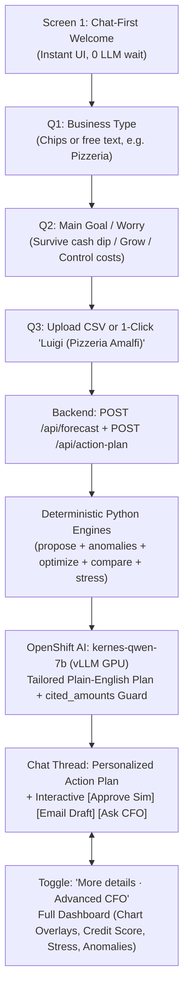

# Implementation Plan — Chat-First Guided CFO + Advanced Dashboard (`16h Sprint`)

## Goal Description
Feedback from the Red Hat / Commerzbank review showed that while the engineering stack (`kernes-qwen-7b` on OpenShift AI vLLM GPU, 170 passing tests, deterministic integer math, 4 autonomy boundaries) is solid, **non-technical SME owners ("Luigi the pizzeria owner") cannot see immediate practical value** when greeted by a cold CSV upload form followed by 8+ analytical widgets.

Instead of rewriting our working backend or changing the tech stack with **16 hours remaining**, we will wrap our existing deterministic engines in a **Chat-First Guided Experience (default)** with a one-click **`More details · Advanced CFO`** toggle that reveals the full analytical dashboard:

1. **Guided 3-Question Interview (instant in frontend, 0 LLM wait on greetings):**
   - **Q1 (Business):** *"What kind of business do you run?"* (Quick-reply chips: `Pizzeria / Restaurant`, `Local retail shop`, `Freelance / Agency` + free text).
   - **Q2 (Goal / Fear):** *"What's your biggest priority right now?"* (Quick-reply chips: `Don't run out of cash`, `Save to buy equipment / grow`, `Spot unexpected costs` + free text).
   - **Q3 (Statement):** *"Drop your bank statement CSV — or try Luigi's Pizzeria Amalfi statement"* (1-click *"Try Luigi's Pizzeria Amalfi"* button pre-fills `EUR 5,000.00` & `2025-06-22` with zero manual form friction).
2. **Personalized Grounded Action Plan (`POST /api/action-plan`):**
   - Backend runs our **existing deterministic calculators** (`propose`, `detect_anomalies`, `optimize_payments`, `compare_financing_options`, `stress_test`, `credit_check`) in one call.
   - `kernes-qwen-7b` synthesizes those exact facts into a **plain-English, Luigi-tailored 2–3 step Survival or Growth Plan** (strictly validated with `cited_amounts` so the LLM can never hallucinate a figure).
   - If the business has a **cash shortfall**: produces a concrete **Survival Plan** (*1. Check duplicate/outlier → 2. Shift payment to cut gap free → 3. Cover remaining gap with short-term credit line*).
   - If the business has **no shortfall (healthy surplus)**: produces a **Safe Growth Plan** (*how much cash buffer to keep after stress-test scenarios vs. how much is safe to reinvest in equipment/savings*).
3. **Interactive Actions Inside the Chat + Progressive Disclosure:**
   - Directly inside the chat thread, Luigi gets interactive simulation buttons (`Approve credit preview`, `Preview client reminder email`, `Ask a follow-up question like "What happens if a selected client pays 3 days later?"`) with all **4 Challenge Card autonomy badges** visible.
   - A prominent topbar/card toggle **`More details · Advanced CFO`** switches seamlessly to the full existing dashboard (Chart with `+7d` / `Stress` / `What-If` overlays, Credit Readiness Score, Stress Test, Smart Payment Moves, Compare Options, Anomalies, Telemetry).

---

## Scope Freeze for the Final 16 Hours

- **Do NOT rewrite balance math** in `backend/forecast.py`, `backend/insights.py`, `backend/advisory_extras.py`, or `deploy/model-gpu.yaml` — our math engine and GPU vLLM deployment are already verified and green. The ONLY touch to `backend/forecast.py` is **additive metadata extraction** (`Transaction Type`, `Beneficiary/Payer`, `Payment Reference`) + a deterministic `classify_transaction()` helper so existing tests remain 100% green.
- Keep the original Red Hat `demo/pizzeria_amalfi_sample.csv` untouched.
- Add **only 1 new backend endpoint** (`POST /api/action-plan`) that composes existing calculators, filters actions by `actionability`, and reuses our existing `ModelConfig` + `cited_amounts` grounding + fallback pipeline.
- Keep all existing dashboard DOM IDs (`#results`, `#compare-card`, `#health-stress-grid`, `#anomalies-card`, etc.) intact inside the **Advanced CFO** view so zero existing functionality or tests break.
- **Demo framing (known payments scenario):** `EUR 5,000.00` on `2025-06-22` is a demo scenario assumption (the reconstructed balance from the full historical statement on that date was `−EUR 8,848.69`). When the CSV already lists operations for the forecast dates, the dashboard uses them as known payments, so on the demo we present this honestly as a **scenario with known/scheduled payments**. When the forecast starts after the statement ends, `backend/history_forecast.py` learns it from history only: the default one-click sample forecasts 1–14 January 2026 from the full 2025 statement, and the same rule is backtested in **PR #17**.
- **Ask CFO scope:** Current `/api/ask-cfo` modifies/shifts existing scheduled payments rather than adding new capex transactions — therefore use *"What happens if a selected client pays 3 days later?"* instead of *"Can I buy a €3,000 oven?"*.
- **Branch discipline (`main` via PR only — NO direct push / NO force-push):** Strongly requested: merge all branches into `main` **only via Pull Request** and never force-push to `main` (GitHub branch protection settings are currently restricted to the repository owner `docRonal`).

---

## Architecture & User Flow



---

## Proposed Changes

### 1a. Transaction Type & Counterparty (`Beneficiary/Payer`) Parser & Classifier

Currently `_parse_bank_statement_csv()` in `backend/forecast.py` reads `Beneficiary/Payer` into `label`, but drops `Transaction Type` and `Payment Reference`. Without knowing what kind of transaction or counterparty each row represents, generic optimizers can suggest impossible actions (e.g., emailing walk-in `"Pizzeria Amalfi Customers (Debit)"` to pay early, or delaying mandatory `"Techniker Krankenkasse"` social security).

#### Modify `backend/models.py` & `backend/forecast.py`
Extend `Transaction` with **backward-compatible optional fields** (`default=None` so all existing JSON fixtures/tests keep passing):
```python
TransactionCategory = Literal[
    "retail_card",
    "card_acquirer",
    "b2b_client",
    "b2b_supplier",
    "rent",
    "owner_draw",
    "staff_payroll",
    "tax_social",
    "utility",
    "other",
]
TransactionActionability = Literal[
    "email_collect_early",      # B2B client invoice -> polite email asking to pay before deadline
    "email_defer_supplier",     # B2B supplier / landlord -> polite email asking for 3-4 day extension
    "owner_draw_flexible",      # Owner's own withdrawal -> owner can temporarily defer
    "fixed_mandatory",          # Taxes, social security, staff payroll, utilities -> NEVER defer
    "retail_non_contactable",   # Walk-in card customers / acquirer payouts -> NEVER email
]
```
Add optional fields on `Transaction`:
- `transaction_type: str | None = None` (from `"Transaction Type"`)
- `counterparty: str | None = None` (from `"Beneficiary/Payer"`)
- `payment_reference: str | None = None` (from `"Payment Reference"`)
- `category: TransactionCategory | None = None`
- `actionability: TransactionActionability | None = None`

Add deterministic `classify_transaction(transaction_type, counterparty, payment_reference, amount_minor)` inside `backend/forecast.py` (invoked during `_parse_bank_statement_csv`):
- **Incoming (`amount_minor > 0`):**
  - `CARD SETTLEMENT` / `Customers (Debit)` → `retail_card` / `retail_non_contactable` (never suggest emailing retail customers).
  - `CREDIT CARD PAYOUT` / `Global Pay` → `card_acquirer` / `retail_non_contactable`.
  - `INCOMING PAYMENT` / B2B client invoice → `b2b_client` / `email_collect_early` (AI drafts polite early-payment email citing `counterparty` + invoice ref from `payment_reference`).
- **Outgoing (`amount_minor < 0`):**
  - `TAX OFFICE` / `Tax Office` / `Social Security` / `Krankenkasse` → `tax_social` / `fixed_mandatory` (never suggest deferring).
  - `SALARY PAYMENT`: if `"Owner"` in `payment_reference` → `owner_draw` / `owner_draw_flexible`; else → `staff_payroll` / `fixed_mandatory` (never defer staff wages).
  - `SUPPLIER PAYMENT` (e.g. `Asimex Wholesale Ltd`, `Fattoria La Vino GmbH`) → `b2b_supplier` / `email_defer_supplier` (AI drafts polite short-extension email citing invoice ref).
  - `RENT PAYMENT` (e.g. `Main Street Real Estate GmbH`) → `rent` / `email_defer_supplier`.
  - `DIRECT DEBIT` energy/utilities → `utility` / `fixed_mandatory`.

---

### 1b. Backend — New Synthesizing Endpoint (`POST /api/action-plan`)

#### Modify `backend/models.py`
Add strict Pydantic models (`extra="forbid"`):
```python
class UserProfile(BaseModel):
    model_config = ConfigDict(extra="forbid")
    business_type: str = Field(default="Small business", min_length=1, max_length=120)
    goal: str = Field(default="Keep cash flow healthy", min_length=1, max_length=240)
    experience_level: Literal["beginner", "advanced"] = "beginner"


class ActionPlanRequest(InsightRequest):
    profile: UserProfile = Field(default_factory=UserProfile)
    currency: str = Field(default="EUR", min_length=3, max_length=3)


class ActionPlanStep(BaseModel):
    model_config = ConfigDict(extra="forbid")
    step_number: int = Field(ge=1, le=5)
    title: str
    detail: str
    autonomy_level: Literal["analyzed", "recommended", "requires_approval", "simulation_only"]
    action_kind: Literal["review_anomaly", "shift_payment", "credit_facility", "growth_buffer", "none"]
    impact_minor: NonNegativeInt = 0
    counterparty: str | None = None
    email_kind: Literal["collect_early", "defer_supplier"] | None = None
    email_draft: str | None = None


class ActionPlanResponse(BaseModel):
    model_config = ConfigDict(extra="forbid")
    mode: Literal["survival", "growth"]
    headline: str
    summary: str
    steps: list[ActionPlanStep] = Field(min_length=1, max_length=4)
    suggested_questions: list[str]
    model: str
    latency_ms: NonNegativeInt | None
```

#### New `backend/action_plan.py`
- Deterministically computes:
  - `proposal = propose(request.baseline, request.transactions)`
  - `anomalies = detect_anomalies(mode="demo", request=...)` (deterministic findings only — zero duplicate LLM calls!)
  - `opt = optimize_payments(InsightRequest(...))` — **filtered by `actionability`** so only `email_collect_early` (B2B clients), `email_defer_supplier` (B2B suppliers / landlord), or `owner_draw_flexible` (owner withdrawal) are recommended; `fixed_mandatory` (taxes/social/staff payroll) and `retail_non_contactable` (walk-in card customers) are strictly excluded!
  - `stress = stress_test(InsightRequest(...))`
  - `comparison = compare_financing_options(mode="demo", request=...)` (deterministic ranking only!)
- Builds `steps: list[ActionPlanStep]` deterministically in Python:
  - **If `proposal is not None` (`mode = "survival"`)**:
    1. If anomalies found → Step: *Check unusual/duplicate charge* (`autonomy_level="analyzed"`, `action_kind="review_anomaly"`).
    2. If an actionable B2B payment move exists → Step: *Contact `<counterparty>` (`email_kind="collect_early"` for B2B client invoice before deadline, or `email_kind="defer_supplier"` for B2B supplier/landlord short extension)* (`autonomy_level="recommended"`, `action_kind="shift_payment"`, `impact_minor=top.saves_minor`, populated with polite editable `email_draft` citing `counterparty` and `payment_reference`!).
    3. Credit facility step → *Cover remaining gap with simulated credit line* (`autonomy_level="requires_approval"`, `action_kind="credit_facility"`, `impact_minor=proposal.limit_minor`).
  - **If `proposal is None` (`mode = "growth"`)**:
    1. Calculate lowest projected balance (`min_bal`) and `stress.recommended_limit_minor` safety buffer.
    2. `safe_to_invest = max(0, min_bal - stress.recommended_limit_minor)`.
    3. Step 1: *Reserve safety buffer* (`autonomy_level="analyzed"`).
    4. Step 2: *Safe budget for growth/equipment* (`safe_to_invest`, `autonomy_level="recommended"`, `action_kind="growth_buffer"`).
- In `live` mode: calls `kernes-qwen-7b` ONCE with `{profile, mode, deterministic steps, exact currency amounts, counterparty names & references}` to generate a warm, jargon-free `headline`, 2–3 sentence `summary`, and polished polite `email_draft` (for `collect_early` or `defer_supplier`) tailored to `profile.business_type` and `profile.goal`. Validates every cited amount with `cited_amounts(text) <= allowed_minor` and strips any leaked internal terms from `email_draft`; retries once and falls back to `kernes-qwen` (or clean 503 if unavailable).
- In `demo` mode: returns deterministic `headline`, `summary`, and template `email_draft` (`model="demo-deterministic"`).

#### Modify `backend/main.py` & `contracts/openapi.json`
Register `@app.post("/api/action-plan", response_model=ActionPlanResponse)` and regenerate `contracts/openapi.json`.

---

### 2. Frontend — Progressive Disclosure Guided Onboarding & Action Plan (Implemented via PR #20)

Instead of a separate `#chat-experience` overlay, **Tsimur** implemented this cleanly inside the existing Bento architecture via **Progressive Disclosure**:

#### Implemented `frontend/assets/js/action_plan.js` & `frontend/assets/css/progressive.css`
- **2-Question Guided Setup (`#setup-screen` in `frontend/index.html`):**
  - **Q1 (`#business-type-input`):** *"What kind of business do you run?"* + quick chips (`Pizzeria / Restaurant`, `Local retail shop`, `Freelance / Agency`) + free text.
  - **Q2 (`#business-goal-input`):** *"What's your main goal right now?"* + quick chips (`Avoid running out of cash`, `Save to buy equipment / grow`, `Spot unexpected costs`) + free text.
  - **Q3 (`#csv-file`):** Pre-loaded *Pizzeria Amalfi example (ready to use)* or custom CSV upload → `Check my cash →`.
- **Simple Action-First Results (`#results`):**
  - Shows the 4-level autonomy strip, headline verdict + 3 KPI tiles, clean interactive SVG chart, grounded AI briefing, **Tailored Next Steps** rendered by `action_plan.js` (`#action-plan-steps` / `#growth-plan-steps`) with `Draft payment email →` CTAs, and the warm charcoal **Action Decision Card** (`1. Short-term safety buffer` / `2. Get paid earlier`).
- **Collapsed Advanced Details (`#advanced-details-section`):**
  - Deeper analytical tools (*What-if simulator & Q&A* + *Client pays late*, *Compare ways to cover the dip*, *Cash health score & stress test*, *Smart payment timing moves*, *Payments worth double-checking*) stay tucked inside collapsible `<details class="detail-accordion">` panels until clicked or expanded via `Expand all`.
  - Suggested follow-up chips include *"What is the riskiest day?"*, *"What if payroll grows by 2,000 EUR?"*, and *"What if the client pays 3 days late?"* (operating on existing scheduled payments, not new capex).

---

### 3. Tests & Deployment

#### New `tests/test_action_plan.py`
- Unit & API tests for `classify_transaction()` and `POST /api/action-plan`:
  - Classifier tests on `demo/pizzeria_amalfi_sample.csv` & `demo/credit_peak_case.csv`: verify `Pizzeria Amalfi Customers (Debit)` → `retail_non_contactable`, `Techniker Krankenkasse` / `Tax Office` / staff salaries (`Yusuf Akcit`, `Rosa Pavese`, `Vanessa Paradi`) → `fixed_mandatory` (never suggested as email/defer targets), `Vincenzo Amalfi` → `owner_draw_flexible`, `Asimex Wholesale Ltd` / `Main Street Real Estate GmbH` → `email_defer_supplier`, and B2B `INCOMING PAYMENT` (`PEAK-003 Client invoice`) → `email_collect_early`.
  - Survival mode on Pizzeria Amalfi (verifies `email_kind == "defer_supplier"` with real supplier/landlord counterparty) and on `credit_peak_case.csv` (verifies `email_kind == "collect_early"` with polite pre-deadline request + `cited_amounts` grounding & fallback).
  - Growth mode on `no_shortfall_case.csv` (verifies `mode == "growth"` and `safe_to_invest` calculation).
  - Multi-currency `PLN` on `demo/stress_cases/amalfi_poland_branch_pln.csv`.
  - Graceful 503 when live model is unavailable.

---

## 16-Hour Execution Timeline & Team Split

| Time Window | Owner | Concrete Deliverable |
| --- | --- | --- |
| **Hours 0–3 (Done — PR #18)** | **Andrii + Ivan** (`feat/backend` / `feat/advice`) | Implemented `Transaction` classification + `UserProfile` / `ActionPlanRequest` / `ActionPlanResponse` in `backend/models.py`, `backend/forecast.py`, `backend/action_plan.py`, wired `POST /api/action-plan` in `backend/main.py`, updated `contracts/openapi.json`, added `tests/test_action_plan.py`. |
| **Hours 0–6 (Done — PR #20)** | **Tsimur** (`feat/frontend`) | Built Progressive Disclosure 2-question onboarding (`#setup-screen`), Action Plan cards (`frontend/assets/js/action_plan.js`, `frontend/assets/css/progressive.css`), and collapsible `#advanced-details-section` accordions preserving all existing dashboard tools. |
| **Hours 6–8** | **Yurii (QA + Lead)** | Run full local pytest (`uv run --locked pytest -q`), verify both Simple Action Plan (Luigi survival + healthy growth) and Advanced accordions locally in Edge Playwright. |
| **Hours 8–10** | **Mikhail** (`feat/openshift`) | Rebuild & redeploy OpenShift container from unified `main` (`app-<sha>`), verify `kernes-qwen-7b` handles `POST /api/action-plan` in <6s, record telemetry evidence. |
| **Hours 10–12** | **Yurii (QA + Lead)** | Run live OpenShift remote pytest + Playwright E2E on both modes; fix any UI/copy rough edges. |
| **Hours 12–16** | **Whole Team** | Freeze code! Project Card answers are maintained directly in `README.md` (no `LICENSE` file per Discord rules); rehearse the 5-minute live interactive demo from `docs/DEMO_SCRIPT_5MIN.md` (Luigi's Pizzeria Amalfi scenario + B2B2C Commerzbank business model) 2x live on OpenShift. |

---

## Ready-to-Send Role Prompts for Team Agents

- **Backend / AI Agent (Ivan / Andrii):**
  > 1) Extend `Transaction` in `backend/models.py` with backward-compatible optional fields (`transaction_type`, `counterparty`, `payment_reference`, `category`, `actionability`) and add a deterministic `classify_transaction()` helper in `backend/forecast.py` (without changing any balance math!) so walk-in card customers (`retail_non_contactable`) and taxes/social security/staff payroll (`fixed_mandatory`) are NEVER suggested for emails or deferral, while B2B client invoices (`email_collect_early`) and B2B suppliers/landlord (`email_defer_supplier`) are explicitly tagged.
  > 2) Implement `POST /api/action-plan` in `backend/action_plan.py` and `backend/main.py`. Compose deterministic outputs from `propose`, `detect_anomalies(mode="demo")`, `optimize_payments` (filtered by `actionability`), `stress_test`, and `compare_financing_options(mode="demo")` into 2–4 structured `ActionPlanStep` items (`mode: "survival"` or `"growth"`), supporting both polite email kinds (`collect_early` for B2B clients before deadline and `defer_supplier` for B2B suppliers/landlord). Call `kernes-qwen-7b` once in `live` mode to tailor `headline`, `summary`, and `email_draft` to `profile.business_type` and `profile.goal`, enforcing `cited_amounts` grounding. Add `tests/test_action_plan.py` and verify `uv run --locked pytest -q`.

- **Frontend Agent (Tsimur):**
  > Maintain the Progressive Disclosure UX (`#setup-screen` 2-question onboarding, `#action-plan-steps` / `#growth-plan-steps` rendered by `frontend/assets/js/action_plan.js` + `frontend/assets/css/progressive.css`, and `#advanced-details-section` collapsible accordions) while keeping simulation-only Approve/Reject controls, editable email drafts, and HTTP 503 resilience intact.

- **Deployment Agent (Mikhail):**
  > After `POST /api/action-plan` and the Chat-First UI merge into `main`, rebuild and redeploy `autonomous-cfo` on OpenShift (`kernes-ai`) keeping `kernes-qwen-7b` (vLLM GPU) primary and `kernes-qwen` fallback. Verify `POST /api/action-plan` latency in `oc logs` and update `deploy/EVIDENCE.md`.
